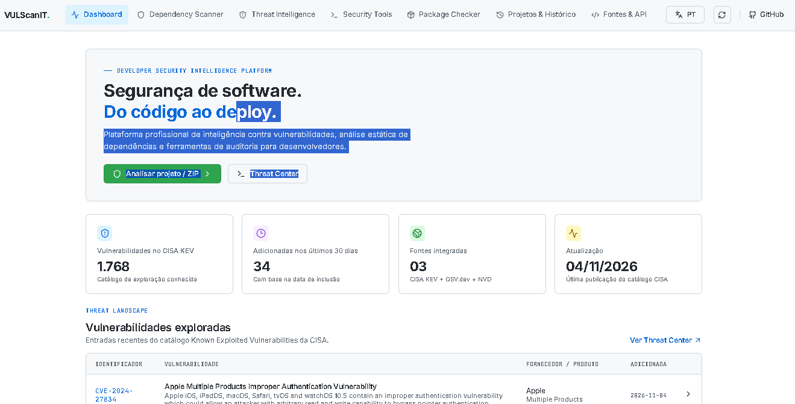
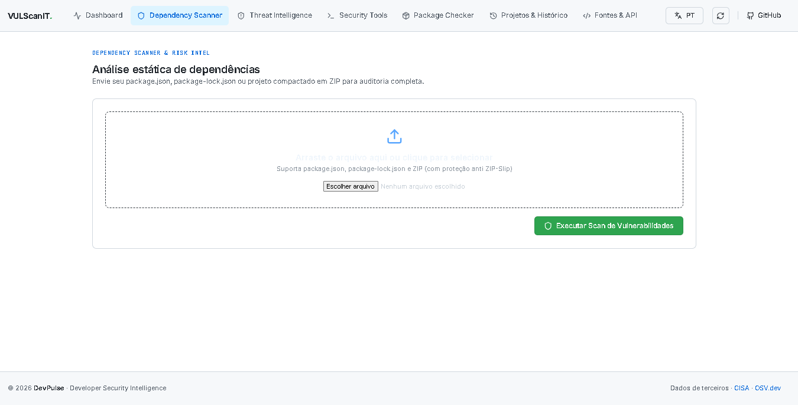
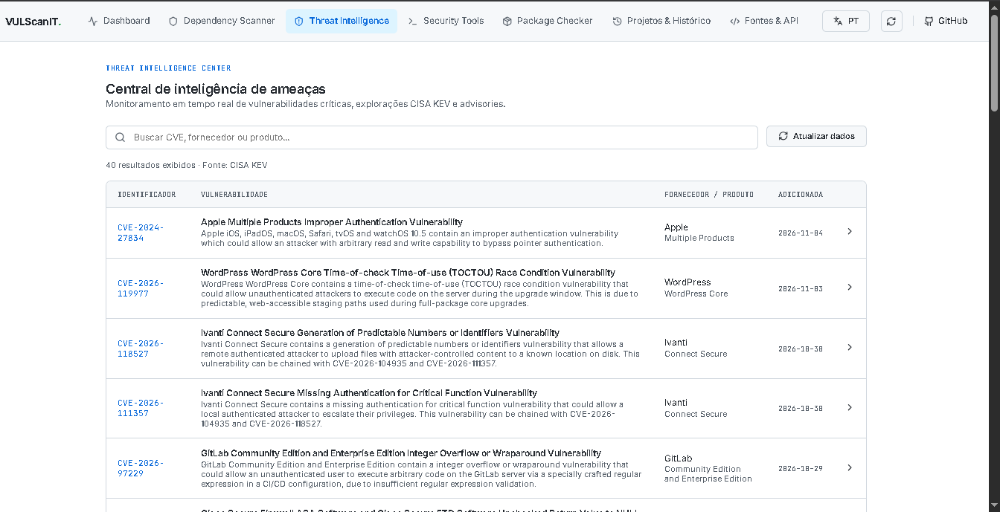
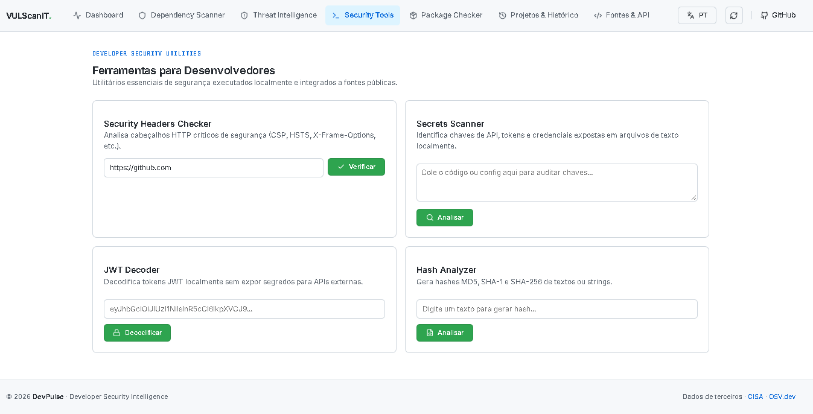
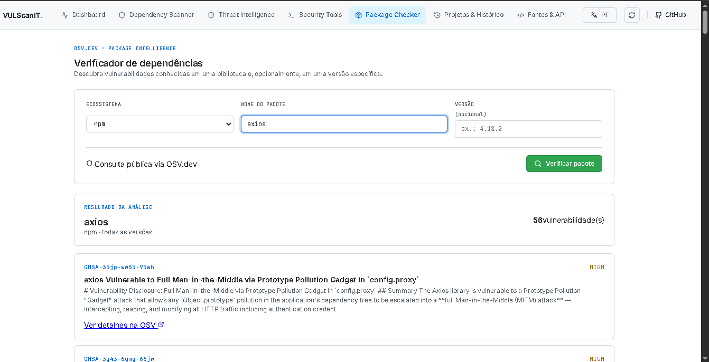
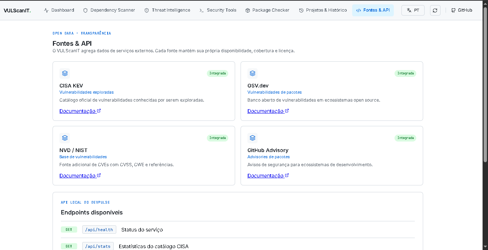

# VULScanIT

Plataforma de inteligência e segurança para desenvolvedores, projetada para auditoria rápida de dependências, consulta de vulnerabilidades (CVEs) e análise de segurança estática.

---

## O que é o VULScanIT?

O **VULScanIT** centraliza ferramentas essenciais de DevSecOps em uma interface web moderna e leve. Ele permite que desenvolvedores identifiquem falhas em dependências, verifiquem advisories de segurança e auditem projetos antes de irem para produção.

---

## 📸 Interface & Telas do Sistema

| Visão Geral / Dashboard | Scanner de Dependências |
| :---: | :---: |
|  |  |

| Threat Intelligence (CISA KEV) | Ferramentas para Desenvolvedores |
| :---: | :---: |
|  |  |

| Detalhes da Vulnerabilidade | Fontes & API |
| :---: | :---: |
|  |  |

---

## Principais Funcionalidades

- **Scanner de Dependências**: Envie arquivos `package.json`, `package-lock.json` ou arquivos compactados (`.zip`) para análise estática e cálculo de Risk Score (0–100) via OSV.dev (com proteção anti ZIP-Slip).
- **Threat Intelligence**: Monitoramento e consulta em tempo real do catálogo CISA KEV (Known Exploited Vulnerabilities) e advisories oficiais.
- **Ferramentas Utilitárias**:
  - **CVE Lookup**: Consulta rápida de vulnerabilidades por ID.
  - **Package Checker**: Verificação de versões e pacotes vulneráveis.
  - **Security Headers Checker**: Inspeção de cabeçalhos de segurança HTTP.
  - **Secrets Scanner**: Detecção estática de chaves, tokens e segredos expostos.
  - **JWT Decoder**: Decodificação local de JSON Web Tokens.
  - **Hash Analyzer**: Comparação e hash de strings (MD5, SHA-1, SHA-256).
- **Internacionalização (i18n)**: Suporte nativo a Português (PT-BR) e Inglês (EN).

## Arquitetura

O projeto é estruturado em monorepo simples:
- **`client/`**: Aplicação frontend desenvolvida em React, Vite e Lucide Icons.
- **`server/`**: API backend desenvolvida em Node.js com Express, integrando com OSV.dev e serviços de advisories.

## Requisitos

- Node.js 18.18+ (ou superior)
- npm

## Como Executar

### 1. Clonar o repositório
```bash
git clone https://github.com/seu-usuario/vulscanit.git
cd vulscanit
```

### 2. Instalar as dependências
```bash
npm install
```

### 3. Configurar variáveis de ambiente (Opcional)
Copie o arquivo de exemplo e ajuste se necessário:
```bash
cp .env.example .env
```

### 4. Executar em modo de desenvolvimento
Para rodar o frontend e o backend simultaneamente:
```bash
npm run dev
```
- **Frontend**: `http://localhost:5173`
- **API Backend**: `http://localhost:4000`

### 5. Executar em produção
```bash
npm run build
npm start
```

## Contribuindo

Contribuições, issues e pull requests são bem-vindos. Sinta-se à vontade para abrir uma issue para discutir melhorias ou relatar bugs.

## Licença

Distribuído sob a licença [MIT](LICENSE).
